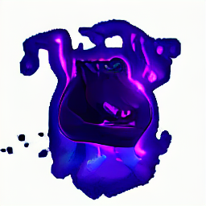

# Generative AI: Coursework

> Homework for **Generative AI** (NYCU, Spring 2025). Six hands-on assignments covering the modern generative-AI stack: prompting LLMs, parameter-efficient fine-tuning, retrieval-augmented generation, data collection, and diffusion models trained from scratch.

  
  
  
  
  
  
  
   <em>Text-to-image samples from the conditional latent diffusion model trained in HW6</em>

## Overview

| # | Topic | What I built | Key techniques |
|:-:|---|---|---|
| 1 | Prompt Engineering | MMLU multiple-choice QA with an LLM API (Gemini 2.0 Flash) | Role prompting, 10-shot in-context learning, output parsing |
| 2 | Abstract Generation | Fine-tuned an LLM to write paper abstracts from introductions | **QLoRA** on Mistral-7B-Instruct (4-bit NF4), back-translation & paraphrase augmentation, beam search |
| 3 | RAG for Scientific QA | Two-stage retrieval QA pipeline over research papers | Hybrid retrieval (dense + BM25), cross-encoder re-ranking, chunking study, anti-hallucination prompt |
| 4 | Web Crawler | CLI crawler for a full year of forum posts, with statistics queries | requests + BeautifulSoup, multiprocessing, argparse sub-commands |
| 5 | DDPM from Scratch | Built a dataset pipeline and trained an unconditional diffusion model | Data crawling → face detection & filtering → U-Net DDPM, cosine β-schedule, EMA |
| 6 | Text-to-Image Diffusion | Trained a conditional latent diffusion model for game-sprite generation | Conditional U-Net + CLIP text encoder, **FiLM conditioning**, classifier-free guidance, DPM-Solver++ |

## Highlights

### HW3: RAG pipeline design study

I swept the dense/BM25 weighting, the chunk size, and sentence-level evidence selection.

| Setting | ROUGE-L | LLM correctness |
|---|:-:|:-:|
| BM25 only | 0.213 | 0.46 |
| Dense 0.3 / BM25 0.7 (chunk 256) | 0.213 | 0.57 |
| Chunk 800 | 0.153 | 0.65 |
| Chunk 800 + sentence selection | 0.176 | 0.57 |
| **Final: hybrid 0.3/0.7, chunk 256, `deepseek-r1:8b` (local, Ollama)** | **0.213** | **0.77** |

Larger chunks raised answer correctness but lowered ROUGE-L. Aggressive sentence filtering also hurt, because it removed context the model needed. [Full report](docs/hw3-rag-report.pdf)

### HW6: Iterating on a diffusion architecture

I took FID from 244 to 80.9 across six model versions. The changes were a deeper U-Net with self- and cross-attention, a switch to the DPM-Solver++ sampler, a FiLM layer that injects the character embedding before the U-Net, Fourier time embeddings, and wider channels. Model 3 (a FiLM-only variant) failed, and the [experiment log](docs/hw6-experiments.md) explains why.

| Model | U-Net (down+mid+up) | FiLM | Sampler | FID ↓ | CLIP-T ↑ | CLIP-I ↑ |
|:-:|:-:|:-:|:-:|:-:|:-:|:-:|
| 1 | 3+0+3 | | DDIM | 244.3 | 0.198 | 0.534 |
| 2 | 4+1+4 | | DPM-Solver | 132.7 | 0.276 | 0.699 |
| 4 | 4+1+4 | ✓ | SDE-DPM-Solver++ | 119.9 | 0.282 | 0.730 |
| 5 | + time-emb layers | ✓ | SDE-DPM-Solver++ | 117.0 | 0.270 | 0.708 |
| **6** | same, 1.5× channels | ✓ | SDE-DPM-Solver++ | **80.9** | **0.298** | **0.815** |

[Full report](docs/hw6-diffusion-report.pdf)

## Source code

Following course policy, the source code lives in a separate private repository. It is available on request.
